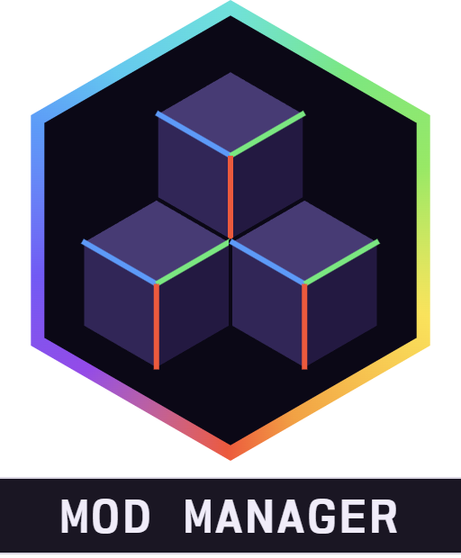

<div align="center">



# Alaydriem's Mod Manager

[](https://github.com/alaydriem/levi-modmanager/releases)
[](https://github.com/alaydriem/levi-modmanager/actions/workflows/ci.yml)
[](./LICENSE)

[](https://github.com/LiteLDev/LeviLamina)

</div>

A mod manager for [LeviLamina](https://github.com/LiteLDev/LeviLamina) client mods. Mods that tie into it get a shared settings panel, keybinds and conflict detection.

## Features

- Mod list
- Settings for each mod
- Keybind management
- Conflict view

<table>
  <tr>
    <td width="50%"></td>
    <td width="50%"></td>
  </tr>
  <tr>
    <td width="50%"></td>
    <td width="50%"></td>
  </tr>
</table>

## Installation

Requires the client build of LeviLamina.

```powershell
lip install github.com/alaydriem/levi-modmanager#client
```

Or download the zip from the [latest release](https://github.com/alaydriem/levi-modmanager/releases/latest) and extract it into `mods/`.

| Manager | Minecraft Bedrock | LeviLamina |
| --- | --- | --- |
| 0.1.0 | 1.26.51 | 26.51.6+ |

## Usage

Open the panel with <kbd>Ctrl</kbd> + <kbd>Shift</kbd> + <kbd>F10</kbd>, or the **Mods** button on the start and pause screens. The key can be changed on the Keybinds page.

Config lives in `mods/alaydriem-mod-manager/config/config.hcl`.

## For mod authors

See [`examples/demo-mod/`](./examples/demo-mod/) for a complete integration. Rust mods use the `amm-client` crate; C++ mods use [`include/alaydriem_mod_manager.h`](./include/alaydriem_mod_manager.h).

Add the manager as a dependency in `manifest.json`:

```json
"dependencies": [
  { "name": "alaydriem-mod-manager", "version": ">=0.1.0 <0.2.0" }
]
```

## Building

Requires Windows x64, [mise](https://mise.jdx.dev), rustup, [cargo-nextest](https://nexte.st) and LLVM (`clang-cl`).

The UI toolkit comes from [levi-crates](https://github.com/alaydriem/levi-crates) by path, so check it out next to this repository as `../levi-crates`.

```powershell
mise trust
mise run preflight
mise run build-mod
mise run test
```

## Mods using the manager

- [Alaydriem's Mini Map](https://github.com/alaydriem/levi-minimap)
- [Alaydriem's Freecam](https://github.com/alaydriem/levi-freecam)
- [Alaydriem's Light Levels](https://github.com/alaydriem/levi-levels)

## License

BSD 3-Clause. Copyright (c) 2026 Charles R. Portwood II. See [LICENSE](./LICENSE). [Nordwand Mono](https://github.com/tywr/Nordwand-Mono) is under the SIL Open Font License 1.1.
